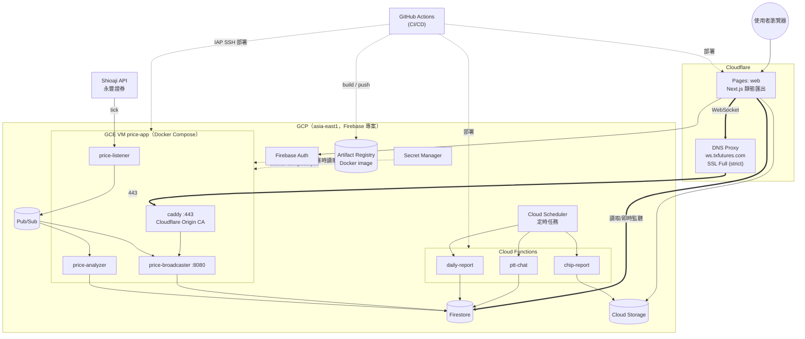
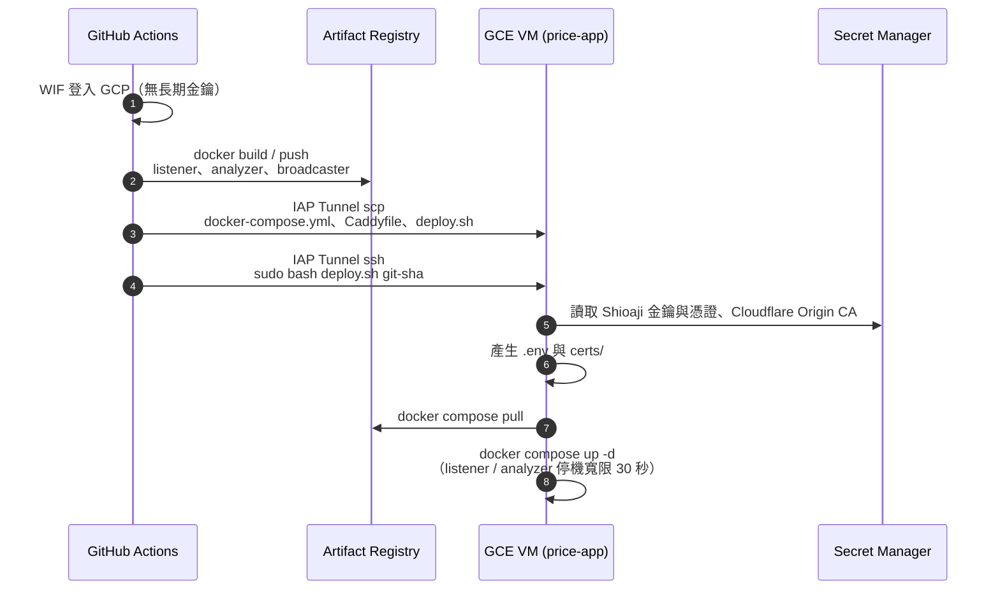
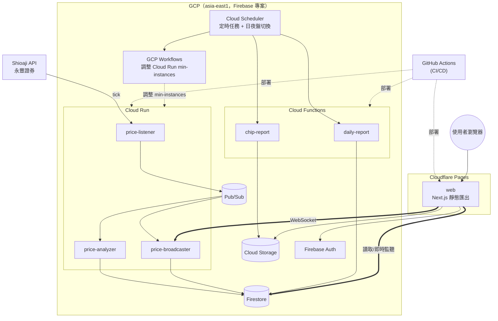
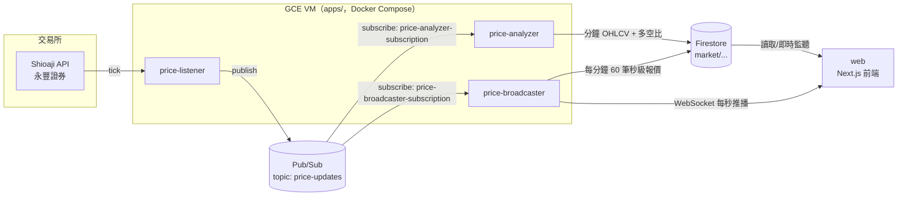
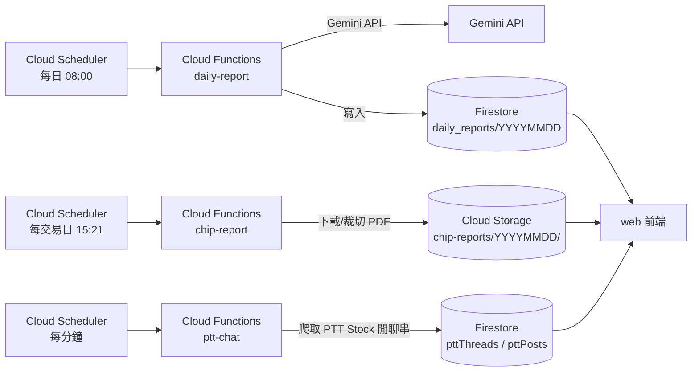

# future-analysis

分析台指期（小型台指期貨）多空交易資訊，即時擷取報價、計算多空指標並提供前端視覺化儀表板。

<a href="https://txfutures.com/" target="_blank">https://txfutures.com </a>

## 專案架構總覽

Monorepo 包含一個前端專案與一組 Python 後端服務（常駐服務跑在 GCE VM，定時任務跑在 Cloud Functions），共用同一個 Firebase/GCP 專案。

| 專案 | 說明 | 文件 |
| --- | --- | --- |
| [web/](web) | Next.js 前端（靜態匯出，部署於 Cloudflare Pages），即時走勢圖、分鐘級多空分析、籌碼快訊、每日 AI 報告，登入後直接讀取 Firestore/Storage | [web/README.md](web/README.md) |
| [apps/price-listener/](apps/price-listener) | 透過永豐 Shioaji API 監聽台指期逐筆報價，發布到 Pub/Sub | [apps/price-listener/README.md](apps/price-listener/README.md) |
| [apps/price-analyzer/](apps/price-analyzer) | 訂閱逐筆報價，聚合成分鐘 OHLCV 並計算多空比，並將每秒報價前向填充後存檔，皆寫入 Firestore | [apps/price-analyzer/README.md](apps/price-analyzer/README.md) |
| [apps/price-broadcaster/](apps/price-broadcaster) | 訂閱逐筆報價，透過 WebSocket 每秒廣播給前端 | [apps/price-broadcaster/README.md](apps/price-broadcaster/README.md) |
| [apps/functions/](apps/functions) | 定時任務：每日 AI 市場分析（Gemini）、籌碼快訊圖表擷取、PTT 盤中/盤後閒聊爬蟲 | [apps/functions/README.md](apps/functions/README.md) |
| [apps/libs/pubsub/](apps/libs/pubsub) | 共用 Pub/Sub Publisher / Subscriber 模組 | [apps/libs/pubsub/README.md](apps/libs/pubsub/README.md) |
| [apps/libs/firestore-writer/](apps/libs/firestore-writer) | 共用 Firestore 寫入模組 | [apps/libs/firestore-writer/README.md](apps/libs/firestore-writer/README.md) |
| [apps/libs/trading-calendar/](apps/libs/trading-calendar) | 共用交易日曆（含國定假日）與「每分鐘判斷是否啟用」的服務生命週期迴圈 | [apps/libs/trading-calendar/README.md](apps/libs/trading-calendar/README.md) |

三個 `apps/price-*` 服務與共用模組由同一個 `apps/` uv workspace 管理，詳見 [apps/README.md](apps/README.md)。

## 系統架構

前端與後端分別部署在不同雲端平台：`web` 是靜態匯出的 Next.js 站台，部署在 **Cloudflare Pages**；三個常駐服務（`price-listener` / `price-analyzer` / `price-broadcaster`）以 Docker Compose 跑在 **GCE 單一 VM**，由 Caddy 終止 TLS 並反代 WebSocket；定時任務仍是 **Cloud Functions**。瀏覽器跨雲直接連線 Cloudflare Pages（畫面）、Cloudflare 代理的 `ws.txfutures.com`（即時報價）與 GCP 上的 Firebase 服務（資料）。



### 部署流程（GCE）

[deploy-apps-gce.yml](.github/workflows/deploy-apps-gce.yml) 以 Workload Identity Federation 登入 GCP，三個服務固定一起建置與部署（VM 上的 compose 共用同一個 `IMAGE_TAG` = git sha）。SSH 一律走 IAP Tunnel，VM 不對外開放 22。



首次建置 VM、防火牆、IAM 與 Cloudflare 設定請見 [infra/gce/README.md](infra/gce/README.md)。部署會重啟服務，建議避開交易時段（13:50–14:55 或休市日）。

## 系統架構（Cloud Run 版本，歷史參考）

> 此為遷移到 GCE 之前的部署架構，保留作為參考；對應的 workflow 為 [deploy-apps.yml](.github/workflows/deploy-apps.yml)，目前仍可手動觸發，但不是主要部署目標。與現行版本的差異：三個服務跑在 Cloud Run，WebSocket 由瀏覽器直連 Cloud Run，並透過 GCP Workflows 在交易時段調整 `min-instances`。



## 資料流程





## GCP 架構

以下為 GCP 元件；`web` 前端與 `ws.txfutures.com` 的 DNS 代理不在此列，改由 Cloudflare 負責（見上方系統架構圖）。

| 元件 | 用途 |
| --- | --- |
| **Compute Engine（GCE）** | 單一 VM `price-app`（`e2-small`，`asia-east1-c`，Debian 13）以 Docker Compose 執行 `price-listener` / `price-analyzer` / `price-broadcaster` / `caddy`，服務以 VM 專用 service account 的 ADC 存取 GCP，不使用金鑰檔 |
| **Cloud IAP** | GitHub Actions 透過 IAP Tunnel SSH 進 VM 部署，防火牆只對外開放 443（Caddy），22 僅允許 IAP 來源範圍 |
| **Cloud Functions (2nd gen)** | 執行 `daily-report` / `chip-report` / `ptt-chat` 三個定時觸發的任務 |
| **Cloud Scheduler** | 平日觸發 `daily-report`（08:00）與 `chip-report`（15:21），每分鐘觸發 `ptt-chat` |
| **Pub/Sub** | `price-updates` topic，`price-analyzer` / `price-broadcaster` 各自以獨立 subscription 訂閱同一批逐筆報價 |
| **Firestore** | 儲存分鐘級 OHLCV／多空分析（`market/{代碼}/{日期}/{HHmm}`）、秒級報價（`market/{代碼}/{日期}_tick/{HHmm}`）、每日 AI 報告（`daily_reports/{日期}`）、PTT 閒聊（`pttThreads` / `pttPosts`） |
| **Cloud Storage** | 存放籌碼快訊裁切後的圖表（`chip-reports/{日期}/`） |
| **Artifact Registry** | 存放三個常駐服務的 Docker image（repository: `apps`），VM 部署時 `docker compose pull` |
| **Secret Manager** | 存放 Shioaji API 金鑰/憑證、Cloudflare Origin CA 憑證/私鑰（`cf-origin-cert` / `cf-origin-key`）、Gemini API Key；VM 於部署時由 `deploy.sh` 讀取，Cloud Functions 以 `--set-secrets` 掛載 |
| **Workload Identity Federation** | GitHub Actions 透過 WIF 冒充 service account 部署，不使用長期金鑰 |
| **Firebase Auth / Firestore / Storage** | 前端 `web` 專案直接以 Firebase SDK 存取，並用 Google 登入限制存取，安全規則見 [firestore.rules](firestore.rules)、[storage.rules](storage.rules) |

三個常駐服務自己依交易日曆（含國定假日）每分鐘判斷是否在啟用窗口：窗口外待機、窗口內建立連線、收盤後收尾（登出、flush、關閉訂閱），不依賴平台層的啟停機制。

### 部署（GitHub Actions，皆為手動 `workflow_dispatch`）

| Workflow | 部署對象 |
| --- | --- |
| [.github/workflows/deploy-apps-gce.yml](.github/workflows/deploy-apps-gce.yml) | **目前使用**：建置並部署 `price-listener` / `price-analyzer` / `price-broadcaster` 到單一 GCE VM（Docker Compose + Caddy），詳見 [infra/gce/README.md](infra/gce/README.md) |
| [.github/workflows/deploy-apps.yml](.github/workflows/deploy-apps.yml) | 舊版：建置並部署同三個服務到 Cloud Run（見上方「Cloud Run 版本，歷史參考」） |
| [.github/workflows/deploy-cron-job.yml](.github/workflows/deploy-cron-job.yml) | 部署 `daily-report` / `chip-report` / `ptt-chat` 到 Cloud Functions |
| [.github/workflows/deploy-firebase-rules.yml](.github/workflows/deploy-firebase-rules.yml) | 部署 Firestore / Storage 安全規則 |
| [.github/workflows/deploy-web.yml](.github/workflows/deploy-web.yml) | 將 `web` 以 `next build` 靜態匯出後，透過 `wrangler-action` 部署到 **Cloudflare Pages**（project: `txfutures`） |

`web` 前端部署在 Cloudflare（非 GCP），建置時以環境變數注入 Firebase 專案設定與 `price-broadcaster` 的 WebSocket 網址（`NEXT_PUBLIC_WS_URL`，GCE 版本為 `wss://ws.txfutures.com`），執行期再跨雲直接連線 GCP 上的 Firebase Auth/Firestore/Storage 與經 Cloudflare 代理的 WebSocket。

### 本地開發

`docker-compose.yml` 啟動 Firebase Emulator Suite（Firestore/Pub/Sub/Storage/Auth），供 `apps/` 與 `web/` 在本地串接測試，設定見 [firebase.json](firebase.json)。

## Firestore 資料結構

頂層集合共四組：`market`（行情）、`daily_reports`（AI 日報）、`pttThreads` / `pttPosts`（PTT 閒聊）、`users`（使用者設定）。

```
market (Collection)
  ┗ 📄 MXF (Document - 商品代碼，合約月份已去除，MXFF6 -> MXF)
        ┣ 📂 20260617 (Subcollection - 交易日 YYYYMMDD，每分鐘分析)
        ┃     ┗ 📄 0901 (Document ID: 時分 HHMM)
        ┃           ├── code: "MXFF6" (String - 含合約月份的完整代碼)
        ┃           ├── timestamp: 2026-06-17T09:01:00+08:00 (Timestamp - 分鐘開始時間)
        ┃           ├── date: "2026-06-17" (String)
        ┃           ├── time: "0901" (String)
        ┃           ├── market_type: "regular" (String - regular 日盤 / after_hours 夜盤)
        ┃           ├── open / high / low / close: 21850 (Number)
        ┃           ├── volume: 1250 (Number - 分鐘總成交量)
        ┃           ├── buy_volume: 700 (Number - 外盤成交量)
        ┃           ├── sell_volume: 550 (Number - 內盤成交量)
        ┃           ├── avg_price: 21853.2 (Number - 分鐘成交均價)
        ┃           ├── tick_count: 312 (Number - 分鐘內 tick 筆數)
        ┃           ├── bid_total_vol / ask_total_vol: 6318 (Number - 委買／委賣總量)
        ┃           ├── analysis: (Map - 多空分析，該分鐘最後一筆 tick 的結果，可能不存在)
        ┃           │     ├── signal: "偏多" (String - 強多 / 偏多 / 中性 / 偏空 / 強空)
        ┃           │     ├── long_ratio / short_ratio: 58.2 (Number - 多空比例)
        ┃           │     ├── confidence: 63.5 (Number - 信心水準 0-100)
        ┃           │     ├── volume_explosion_level: "放量" (String - 正常 / 放量 / 爆量 / 嚴重爆量 / 極度爆量)
        ┃           │     ├── sentiment_label: "偏貪婪" (String - 極度恐慌 ~ 極度貪婪)
        ┃           │     ├── sentiment_score: 0.35 (Number - 市場情緒分數)
        ┃           │     ├── volatility: 42 (Number - 波動率 0-100，Choppiness Index)
        ┃           │     ├── basis: 205.6 (Number - 期現價差，期貨 - 現貨)
        ┃           │     └── basis_pct: 0.94 (Number - 期現價差百分比)
        ┃           ├── created_at (Timestamp - 伺服器時間)
        ┃           └── updated_at (Timestamp - 伺服器時間)
        ┗ 📂 20260617_tick (Subcollection - 秒級報價，與分鐘資料同一交易日)
              ┗ 📄 0901 (Document ID: 時分 HHMM，固定 60 筆)
                    ├── 00: { price: 21850, underlying_price: 21644.4, volume: 12 } (Map)
                    ├── 01: { price: 21851, underlying_price: 21644.9, volume: 0 }
                    ├── ...
                    ├── 59: { ... }
                    ├── created_at (Timestamp)
                    └── updated_at (Timestamp)

daily_reports (Collection)
  ┗ 📄 20260617 (Document ID: 日期 YYYYMMDD)
        ├── date: "2026-06-17" (String)
        ├── raw_content: "..." (String - Gemini 產生的 Markdown 報告)
        ├── summary: {} (Map - 目前留空，保留給結構化資料)
        ├── model_used: "gemini-3.6-flash" (String)
        ├── created_at: "2026-06-17T08:00:12+08:00" (String - ISO 8601，台北時間)
        └── updated_at (Timestamp - 伺服器時間)

pttThreads (Collection - 只有 intraday / afterhours 兩份文件，隔天直接覆蓋)
  ┗ 📄 intraday | afterhours (Document ID: 閒聊時段)
        ├── date: "20260617" (String - 此文件內容所屬日期)
        ├── article_url: "https://www.ptt.cc/bbs/Stock/M.xxx.html" (String)
        ├── last_fingerprint: "..." | null (String - 最後一則已寫入推文的指紋)
        └── created_at / updated_at (Timestamp)

pttPosts (Collection - 依日期保留歷史)
  ┗ 📄 20260617_intraday (Document ID: {YYYYMMDD}_{session})
        ├── posts: [ { userid, content, push_tag, time }, ... ] (Array - 該篇文章的推文)
        └── created_at / updated_at (Timestamp)

users (Collection)
  ┗ 📄 {uid}
        ┗ 📂 setting (Subcollection)
              ┗ 📄 pttReadState (Document - 單一文件)
                    ├── intraday: { date: "20260617", last_read_index: 120 } (Map - 盤中已讀位置)
                    ├── afterhours: { date: "20260617", last_read_index: 80 } (Map - 盤後已讀位置)
                    ├── width: 640 (Number - 閒聊視窗寬度 px)
                    └── height: 600 (Number - 閒聊視窗高度 px)
```

### 說明

- **夜盤跨日**：夜盤 00:00–05:59 的分鐘與秒級資料歸屬「前一個交易日」的日期集合，`date` 欄位同為前一天；`timestamp` 仍是實際時間。
- **自動時間戳記**：後端透過 `FirestoreWriter` 寫入時，會自動補上 `created_at`（僅首次）與 `updated_at`（每次寫入）。
- **覆蓋寫入**：分鐘與秒級文件以 `HHMM` 為 ID 覆蓋寫入，服務重啟時重啟那一分鐘的資料只含重啟後的 tick（見 [infra/gce/README.md](infra/gce/README.md)）。
- **PTT 結構細節**（爬蟲流程、已知限制）請見 [apps/functions/README_PTT_CHAT.md](apps/functions/README_PTT_CHAT.md)。

### 寫入者與讀取權限

| 集合 | 寫入者 | 讀取者 | 讀取規則（[firestore.rules](firestore.rules)） |
| --- | --- | --- | --- |
| `market/{代碼}/{日期}` 與 `{日期}_tick` | `price-analyzer` | `web` | 需登入，且日期落在最近 5 天內（含當天） |
| `daily_reports/{日期}` | `daily-report` | `web` | 需登入，且日期落在最近 5 天內 |
| `pttThreads/{session}`、`pttPosts/{日期}_{session}` | `ptt-chat` | `web` | 需登入 |
| `users/{uid}/setting/pttReadState` | `web`（使用者本人） | `web` | 僅本人可讀寫 |

後端服務使用 service account（Admin SDK），不受安全規則限制；前端 `web` 只能依上表規則讀取。

## Tick 資料結構（Shioaji）

```python
Tick(
    code='MXFF6',                                  # 期貨商品代碼 (例如：MXFF6 代表 微型臺指期貨 2026年6月合約)
    datetime=datetime.datetime(2026, 5, 25, 16, 19, 39, 243000), # 交易所派發該筆行情的時間 (精確至微秒)
    open=Decimal('43845'),                         # 今日開盤價
    underlying_price=Decimal('43644.4'),           # 現貨標的指數當前價格 (例如大盤加權指數，用以計算期現貨價差)
    bid_side_total_vol=6318,                       # 委買總量 / 買方所有掛單委託的總口數
    ask_side_total_vol=5685,                       # 委賣總量 / 賣方所有掛單委託的總口數
    avg_price=Decimal('43908.066462'),             # 今日截至目前的成交均價 (總成交金額 / 總成交口數)
    close=Decimal('43920'),                        # 最新成交價 (當前這一筆撮合的價格)
    high=Decimal('43974'),                         # 今日盤中最高價
    low=Decimal('43806'),                          # 今日盤中最低價
    amount=Decimal('263520'),                      # 單筆成交金額 (此筆撮合口數所對應的契約價值或實質金額)
    total_amount=Decimal('542396345'),             # 今日累計總成交金額
    volume=6,                                      # 單筆成交量 / 本次撮合成交口數 (Lot)
    total_volume=12353,                            # 今日累計總成交量 (口數)
    tick_type=2,                                   # 成交內外盤判定 {1: 外盤/買進, 2: 內盤/賣出, 0: 無法判定}
    chg_type=2,                                    # 漲跌狀態標記 {1: 漲停, 2: 上漲, 3: 平盤, 4: 下跌, 5: 跌停}
    price_chg=Decimal('50'),                       # 漲跌價差 (最新成交價對比昨日收盤/結算價的絕對差額)
    pct_chg=Decimal('0.113973'),                   # 漲跌幅百分比 (例如：0.113973 代表上漲了約 0.114%)
    simtrade=False                                 # 是否為盤前/盤中試撮狀態 {True: 試撮未真正成交, False: 實時正式成交}
)
```
